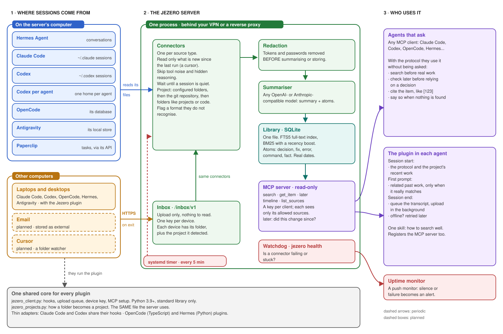

# Jezero

**A shared, searchable library of your agents' past work.**

[](https://github.com/MarsGotta/jezero/actions/workflows/ci.yml)
[](LICENSE)
[](pyproject.toml)
[](https://modelcontextprotocol.io)

Your agents forget. Their sessions pile up as gigabytes of transcripts on several
machines, and your email holds decisions nobody wrote down anywhere else. Jezero
collects those sources, turns each session or thread into a short summary plus
**atoms** (decisions, rationale, fixes, exact errors, commands that worked, facts,
risks), and serves it all, read-only, to every agent you run over
[MCP](https://modelcontextprotocol.io).

<p align="center">
  
</p>

Sessions flow from left to right: read on the server (or uploaded by a plugin from other
computers), cleaned, summarised once, stored in one SQLite file, then read by any number
of agents. More detail in [docs/architecture.md](docs/architecture.md).

## What it looks like

You ask an agent about something another agent did weeks ago, on another computer. You
do not mention Jezero; the plugin taught it to look:

```text
you    > What did we end up doing with analytics on the shop site?

agent  · search("analytics shop site")
           [412] 2026-09-03  Shop site: remove the analytics script
           [431] 2026-09-10  Shop site: analytics back, only after consent
agent  · later(412, "analytics")
           [431] newer, same subject

agent  > It changed once. On 3 Sep the script was removed [412]; on 10 Sep it came
         back, loaded only after the visitor accepts the consent banner [431].
         That is the current state.
```

Each item is a summary with atoms, the date it happened and its project:

```text
[431] Shop site: analytics back, only after consent        2026-09-10 · shop
summary   The analytics script returns, loaded only after consent. No cookies before.
atoms     decision  Load analytics only after the visitor accepts the banner.
          why       Consent is required before any tracking.
          fix       The banner test ran before the script loaded; wait for the event.
          command   npm run test:consent
```

(Synthetic example. Jezero never ships real transcripts.)

*The name:* Jezero is the Martian crater that once held a lake. Its layered sediments
keep the record of what happened there, and the Perseverance rover sets samples aside in
it so they can be picked up later. That is the whole idea of this project.

**Status: pre-alpha.** Storage, search, the MCP server, configuration, the summarizer,
connectors for Hermes Agent, Claude Code, Codex, OpenCode, Antigravity and Paperclip,
plugins that bring sessions from other computers, unattended runs and the watchdog are
implemented and tested. Email comes next.
`jezero check-config` tells you which connector types are available in your version.

## Why this design

- **Write once, read many.** The expensive step (a cheap LLM summarising a session) runs
  once per item. Reads are plain full-text search: milliseconds, no GPU, no LLM, so ten
  or more agents can query at the same time.
- **Keyword search over summaries, not embeddings over raw text.** Transcripts are mostly
  tool output. Summaries plus "questions that would find this" make BM25 work well and
  keep the index small. Vector search can be added later in the same file
  ([sqlite-vec](https://github.com/asg017/sqlite-vec)) if keyword search falls short.
- **One SQLite file.** No database server to run or upgrade. WAL mode lets many readers
  work while a connector writes. Backups are a file copy.
- **Recency matters.** Results are boosted when recent (configurable half-life), so an
  old price or an abandoned decision does not outrank the current one.
- **Separate write and read paths.** Connectors only write to the library and only read
  from your sources. Agents only read. There is no write tool over MCP.

## Quick start

Requires Python 3.12+, SQLite 3.45+ (bundled with recent Python builds) and
[uv](https://docs.astral.sh/uv/).

```bash
git clone https://github.com/MarsGotta/jezero.git && cd jezero
uv sync
cp jezero.example.toml jezero.toml   # then edit it
uv run jezero check-config
uv run jezero init

# Try it with the synthetic sample items
uv run jezero import-jsonl examples/items.example.jsonl --source demo
uv run jezero search "migration rollback"

# Serve over MCP (Streamable HTTP)
uv run jezero new-token   # a token for the client, a digest for the config
uv run jezero serve
```

Connect a client, for example Claude Code:

```bash
claude mcp add --transport http jezero http://127.0.0.1:8765/mcp \
  --header "Authorization: Bearer <token>"
```

## MCP tools

| Tool | What it does |
|---|---|
| `search` | BM25 over titles, summaries, questions and atoms, boosted by recency. Filters: `project`, `source`, `since`. |
| `get_item` | One item in full; the original text only on request. |
| `timeline` | Items in reverse chronological order for a project, source or period. |
| `later` | Newer items in the same project on the same subject as a given item, newest first. Agents are told to call it before relying on a decision, plan or status. |
| `list_sources` | Sources visible to the calling client, with counts and latest date. |

All tools are annotated read-only. Each client sees only the sources its config entry
allows (glob patterns), so a coding agent does not have to see your mail.

## Other computers: plugins

Sessions on other computers reach Jezero through plugins for Claude Code, Codex, OpenCode,
Hermes Agent and Antigravity, which also make agents use Jezero by habit (a short protocol and recent project
work at session start, related past work on the first prompt). No SSH needed: each
computer creates its own key, the server approves its fingerprint, and sessions are
uploaded when they end. See [clients/README.md](clients/README.md).

The plugins install straight from this repository:

```bash
claude plugin marketplace add MarsGotta/jezero && claude plugin install jezero@jezero
codex plugin marketplace add MarsGotta/jezero    # then install Jezero from /plugins
hermes plugins install MarsGotta/jezero/plugins/hermes --enable
agy plugin install https://github.com/MarsGotta/jezero/tree/main/plugins/antigravity
```

OpenCode loads the folder `plugins/opencode` (or `setup` installs it for you).

They stay quiet until the computer is connected to your server with
`jezero_client.py init` (step 2 in the clients guide).

## Configuration

Everything lives in one TOML file: storage, search tuning, summarizer endpoint, server
(host, port, public URL behind a proxy), clients and their allowed sources, connectors,
redaction and the watchdog. [`jezero.example.toml`](jezero.example.toml)
documents every field.

**Secrets never go in the config.** Fields ending in `_env` hold the *name* of an
environment variable. Inline secrets in connector options are rejected at load time.
A git-ignored `.env` file next to the config is loaded automatically; variables already
set in the environment take precedence. `check-config` reports which variables are set
without printing their values.

## Security model

- A bearer token per client, compared by SHA-256 digest in constant time.
- Unauthenticated mode is refused unless the server binds to a loopback address.
- DNS-rebinding protection on the HTTP transport (Host and Origin checks).
- Secrets are redacted before anything is summarised, stored or indexed.
- Content written by third parties (email) is stored with `trust = "external"`, and the
  server instructions tell agents to treat it as data, never as instructions.
- Search queries are always quoted before reaching FTS5, so they cannot inject operators.
- Devices that upload sessions use their own key, created on the device; the server only
  stores its SHA-256. An upload key can write only into its own inbox folder, and the
  MCP server stays read-only. Uploaded transcripts are kept as sent on the server (like
  the agents' own stores on each computer); redaction applies before summarising.
- The plugin bundle at `/client/jezero-client.tar.gz` is public code and needs no key.

See [SECURITY.md](SECURITY.md) to report a vulnerability.

## Development

```bash
uv sync
uv run pytest
uv run ruff check src tests scripts clients
uv run ruff format --check src tests scripts clients
git config core.hooksPath .githooks   # enables the privacy pre-commit check
python3 scripts/privacy_check.py --all
```

The pre-commit hook blocks commits that contain absolute home paths, private network
addresses, credential shapes, or any term listed in your private, git-ignored
`.privacy-denylist`. See [CONTRIBUTING.md](CONTRIBUTING.md).

## Running it unattended

`jezero run --due` runs the connectors whose interval has elapsed, `jezero health` flags
connectors that went quiet. Ready-made systemd user units and a cron line are in
[`deploy/`](deploy/README.md).

## Roadmap

1. Gmail connector (read-only scope, per thread, newsletters skipped).
2. A folder watcher for agents without hooks (Cursor) on other computers.
3. A retrieval benchmark command (questions with expected hits, top-k accuracy).
4. Optional vector search with sqlite-vec.

## License

[Apache-2.0](LICENSE)
