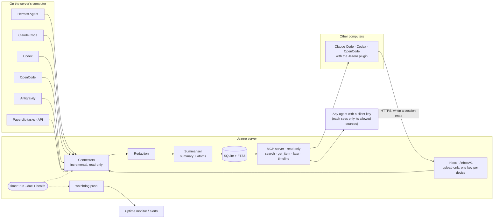

# How the pieces connect

Jezero is one server and a set of thin clients. Sessions flow from left to right: they
are read (or uploaded), cleaned, summarised once, stored in a single SQLite file and then
read by any number of agents over MCP.

## The parts

| Part | Where | What it does |
|---|---|---|
| Connectors | `src/jezero/connectors/` | One per source type. Read only what is new since the last run (a cursor), skip tool noise and hidden reasoning, wait until a session is quiet, find its project. |
| Project rules | `src/jezero/projects.py` | Configured folders, then the git repository (main repository for worktrees), then common root folders. The same file runs on the server and on devices. |
| Redaction | `src/jezero/redact.py` | Removes credential shapes before anything is summarised or stored. `jezero redact-stored` re-applies newer rules to stored items. |
| Summariser | `src/jezero/summarize.py` | Any OpenAI- or Anthropic-compatible endpoint. One call per session or segment, never on reads. |
| Store | `src/jezero/store.py` | One SQLite file, FTS5 trigram index, BM25 with recency. |
| MCP server | `src/jezero/server.py` | Read-only tools, a bearer key per client, per-client source filters. Also hosts the device inbox and the plugin bundle. |
| Device client | `clients/core/jezero_client.py` | Standard library only. Hooks, upload queue with retries, device key, MCP setup. |
| Plugins | `clients/claude-code`, `clients/codex`, `clients/opencode` | Thin adapters over the client, plus one skill shared by all. |

## One session, step by step

1. The plugin gives the agent a short protocol and the project's recent work at the start
   of a session, and related past work on the first prompt.
2. When the session ends it is queued and uploaded in the background (or, on the server's
   own computer, the connector finds it).
3. Redaction removes secrets; the summariser writes a summary and atoms.
4. The item is stored with the date it happened and its project.
5. Later, any agent finds it with `search`, reads it with `get_item` and checks with
   `later` whether a newer session changed the decision.
