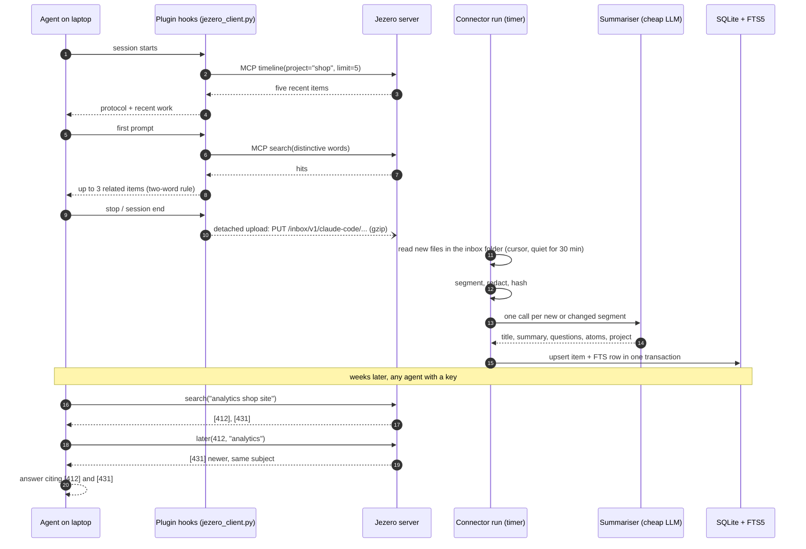
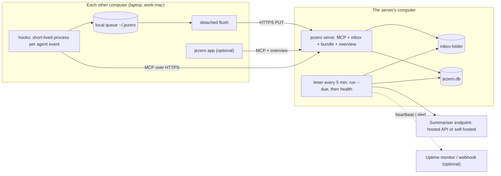

# Architecture

How Jezero's parts fit together, what each one is allowed to do, where it runs, and what
happens when one of them fails. Read this before changing a component's boundary.

## The shape in one paragraph

Jezero is one server and a set of thin clients. Sessions flow in one direction: a
[connector](../reference/connectors.md) reads them (from an agent's store on the server's
computer, or from the inbox where plugins on other computers upload them), the pipeline
removes secrets and asks a cheap model for a summary plus atoms, and the store keeps the
result as one *item* in a single SQLite file. Agents read that file through a read-only
[MCP server](../reference/mcp-tools.md). The expensive step runs once per item, when it is
written; every read is a full-text query that takes milliseconds and needs no model.

The write path and the read path never cross. Connectors write to the library and only
read from sources. Agents only read. Nothing an agent sends over MCP can add, change or
delete an item.

## The life of a session

Follow one session from start to finish: a Claude Code session on a computer called
`laptop`, in the project `shop`, about the analytics script on the shop site.

1. **Session start.** The plugin's hook prints a short protocol (search before
   non-trivial work, check `later` before relying on a decision, cite ids, never guess)
   and the five most recent items of the current project, found with the `timeline`
   tool. The project comes from the working folder, by the same rules the server uses.
2. **First prompt.** The hook takes the prompt's distinctive words, runs `search` and
   shows at most three hits, and only those where at least two of the prompt's words
   appear in the hit's title or summary. Later prompts in the same session add nothing.
   [How search ranks results](search.md#context-on-the-first-prompt) explains the rule.
3. **Stop and session end.** The hook writes a small pointer file to a local queue and
   starts a detached process that uploads the transcript. The agent does not wait for it.
   On `stop` the upload is throttled to once every 15 minutes per session; `session-end`
   always uploads. If the server cannot be reached the pointer stays queued, and the next
   session start sends it.
4. **Inbox.** The server checks the device key, checks that the key may upload, checks
   the path against the pattern of that agent's own store and the size limit, and writes
   the file atomically under `<inbox>/laptop/claude-code/...`. The project the device
   found travels in a header and is kept next to the file. The file's modification time
   is the upload time, so a computer that was offline for a week does not upload "into
   the past" behind a connector's cursor.
5. **Connector run.** A timer runs `jezero run --due` every few minutes. The connector
   for this device's Claude Code sessions picks up files newer than its cursor that have
   been quiet for `settle_minutes` (30 by default), keeps the dialogue and one line per
   tool call, skips tool results and hidden reasoning, and cuts long sessions into stable
   segments.
6. **Pipeline.** Each segment is redacted and hashed. A segment whose hash is already
   stored is skipped without a model call; the others go to the summariser, at most
   `max_concurrency` at a time. The answer is stored by `(source, external_id)`, and the
   full-text row is written in the same transaction. The cursor moves only when every
   segment of the batch was stored.
7. **Reading.** Weeks later an agent on another computer searches, reads the hit with
   `get_item`, checks with `later` whether a newer session changed it, and answers citing
   `[412]` and `[431]`. Item ids are stable, so a citation stays valid.

On the server's own computer, step 4 does not exist: connectors read the agents' stores in
place, and the plugins there are set up with `--no-upload`, so they only add context.

## Components and their boundaries

| Component | Code | Reads | Writes | Never |
|---|---|---|---|---|
| Connectors | `src/jezero/connectors/` | one source type: agent stores, inbox folders, a task board's API (GET only) | nothing directly; hands documents to the pipeline | modifies a source |
| Pipeline | `pipeline.py`, `redact.py`, `summarize.py` | documents from a connector | items and the connector's state | gives the model tools, or runs anything the model says |
| Store | `store.py` | | one SQLite file: `items`, the FTS5 mirror `items_fts`, `connector_state`, `meta` | runs a server process |
| MCP server | `server.py` | the store, through read-only connections | nothing | exposes a write tool |
| Inbox | `server.py`, `inbox.py` | uploads from device keys with `upload = true` | files under that device's own folder | summarises or indexes anything |
| Client core and plugins | `clients/` | the agent's hook payloads, its transcripts | a local queue, uploads | blocks or breaks the agent |
| App | `src/jezero/ui/` | the MCP tools and `/api/v1/overview`, with this computer's key | nothing on the server | opens the database file |

A few of these boundaries are worth spelling out.

**Connectors know formats; the pipeline knows policy.** A connector understands one source:
where its files are, which records are dialogue, how to find the project, when a session is
finished. Everything that must be the same for every source (redaction, deduplication by
content hash, the summariser call, the cursor rule) lives once in the pipeline. That is why
the inbox stores raw files in the same layout as each agent's own store: the existing
connectors read a device's folder unchanged, and nothing about summarising is duplicated
on the upload path. Adding a source type is one module that declares a `CONNECTOR_TYPE`;
see [Add a source](../how-to/sources.md).

**The store is a library, not a service.** `Store` opens a connection per operation. Writes
use `BEGIN IMMEDIATE` transactions, so SQLite serialises writers. Reads open the file with
`PRAGMA query_only = ON`, and WAL mode lets many readers work while a connector writes.
The item and its full-text row are written in the same transaction, so a search never sees
half an item. The schema is in the [data model reference](../reference/data-model.md).

**The MCP server holds no state of its own.** It runs the MCP SDK's Streamable HTTP
transport in stateless mode with JSON responses, maps each bearer key to a configured
client, and filters every tool by that client's allowed sources. Restarting it loses
nothing. The same process also serves the device inbox, the public plugin bundle at
`/client/jezero-client.tar.gz` and the `GET /api/v1/overview` counts for the app. Those
are plain HTTP routes, not MCP tools; [design decisions](design-decisions.md) explains
why.

**The client core is the only code on other computers.** `clients/core/jezero_client.py`
is one file, standard library only, Python 3.9 or newer. Each plugin is a thin adapter that
maps its agent's events to a command of that file. The build script copies the core (and
the shared project rules and skill) into every plugin, so each plugin folder is complete
on its own. See the [client reference](../reference/client.md).

**The app is another reader.** The `jezero` terminal app and the people commands (`find`,
`show`, `agents`) use the same key and the same MCP tools as an agent, plus the overview
endpoint. They see only the sources their key allows, and the "Agent view" screen shows
exactly the context the hooks would inject. The admin commands on the server
(`jezero search`, `jezero stats`) are different: they open the database file directly.

## What runs where

- **The server's computer** runs two things. `jezero serve` is a long-running process
  (the systemd unit stops it within 10 seconds, because clients keep streams open and the
  default wait made restarts slow). A timer runs `jezero run --due` and then
  `jezero health`, every five minutes in the units shipped in `deploy/`. Each connector
  has its own `interval_minutes` (15 by default); `--due` skips the ones whose interval has
  not elapsed. See [Deploy Jezero](../how-to/deploy.md).
- **The summariser** is any Anthropic or OpenAI-compatible endpoint: a hosted API or a
  model on your own hardware. Only connector runs and `jezero resummarize` call it; reads
  never do.
- **Other computers** run nothing permanently. Each agent event starts the hook command,
  which prints context or queues a file and exits. Uploads run in a separate, detached
  process that holds a lock, so two flushes never overlap.
- **The watchdog** is part of `jezero health`. It marks a connector `stale` when it has
  not succeeded for `max_silence_hours` (24 by default) and `failing` when its last run
  recorded an error, can post a webhook alert (at most once per `realert_hours` per
  connector) and can ping a push monitor on every check, so that a dead timer also shows
  up as silence. See [Monitor Jezero](../how-to/monitor.md).

## Failure isolation

Jezero sits next to tools people use all day. The design goal is that a broken Jezero
costs you some memory, never a broken agent or a corrupt library.

**Hooks never break agents.** Every hook runs inside a catch-all: an exception is written
to `~/.jezero/client.log` and the hook prints nothing. Network calls from hooks time out
after 2.5 seconds (`JEZERO_HOOK_TIMEOUT`). Uploads happen in a detached process, so a slow
or unreachable server never delays an agent's turn. A server that refuses a file for good
(400, 403, 413 or 415) gets it dropped from the queue; any other failure keeps the queue
and stops the flush until next time.

**Connectors keep cursors.** Each connector stores an opaque cursor (for file-based
sources, the newest modification time it fully processed). The pipeline advances it only
when every document of the batch was summarised and stored and the connector reported no
warnings. A failed run therefore retries the same files next time, and the content hash
makes the retry cheap: segments already stored are skipped without a model call. A
connector that finds a format it no longer understands reports a warning; the pipeline
records it as the connector's error and holds the cursor, so `jezero health` keeps
showing the problem until it is fixed, instead of the connector silently skipping data.

**One broken source does not stop the others.** `jezero run` runs connectors one after
another and catches each one's exception, records it in that connector's state and moves
on. A summariser call that fails after its retries counts as one failed document, not a
failed run. Malformed model output is caught the same way.

**One run at a time.** `jezero run`, `retag` and `resummarize` take an exclusive lock on a
file next to the database. A timer that fires during a long manual backfill skips with
"another run is in progress" instead of summarising the same sessions twice.

**Sessions are summarised when they are finished.** Connectors defer a session until it
has been quiet for `settle_minutes`, so a conversation in progress is not summarised every
few minutes. When a long session grows, only its last segment changes (see
[segmenting](summaries.md#long-sessions-are-cut-into-segments)), so only that segment is
summarised again.

**Readers cannot hurt the library.** MCP connections are `query_only`, so even a bug in a
tool cannot write. A crash of `jezero serve` loses no data; a crash during a connector run
rolls back the open transaction.

## See also

- [How search ranks results](search.md): what happens inside `search` and `later`.
- [Summaries and atoms](summaries.md): what the summariser is asked for, and why.
- [Security model](security.md): keys, sources, redaction and what is not protected.
- [Design decisions](design-decisions.md): the choices behind this shape, with the
  alternatives that were rejected.
