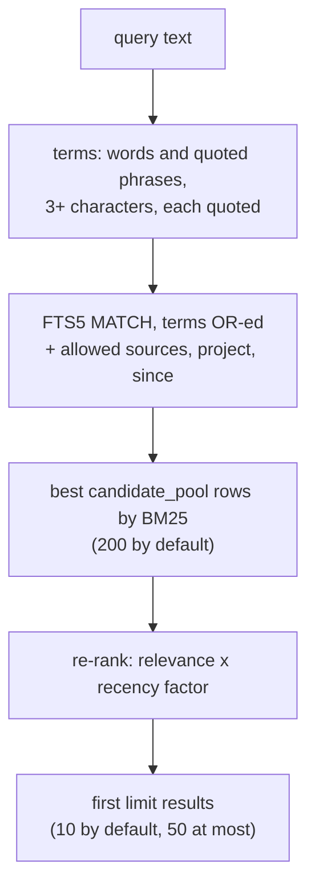
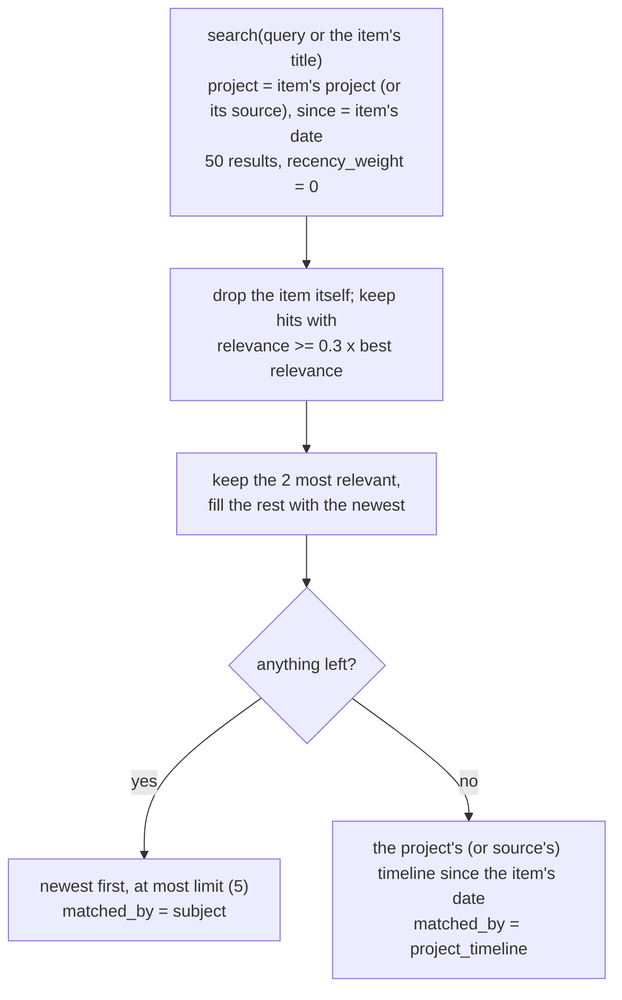

# How search ranks results

What happens between an agent's query and the list of items it gets back: how words
match, how relevance and recency combine, how `later` decides that an item is newer on
the same subject, and how the plugins decide that past work is related to a first prompt.

## The short version



Search is literal and runs entirely inside SQLite. No model is involved, so a query takes
milliseconds and gives the same answer every time for the same library.

## What is indexed

Each item is mirrored into an FTS5 table, `items_fts`, with five columns. Each column has
its own weight in the BM25 formula (`BM25_WEIGHTS` in `src/jezero/store.py`):

| Column | Content | Weight |
|---|---|---|
| `title` | the item's title | 2.0 |
| `summary` | two to five sentences | 1.0 |
| `questions` | the "questions that would find this", one per line | 1.5 |
| `atoms` | the text of every atom, one per line (the kind is not indexed) | 1.5 |
| `project` | the project slug | 0.5 |

A match in the title counts twice as much as the same match in the summary; questions and
atoms sit in between. The code records the weights, not how they were chosen, but the
effect follows the purpose of each field: the title is the most condensed statement of
what an item is about, and questions and atoms are written by the summariser precisely to
be found later (see [Summaries and atoms](summaries.md)). The project column weighs little
because it is the same word for every item of a project; to restrict a search to one
project, use the `project` filter instead.

The original transcript is not indexed. It is stored next to the item (redacted) and
returned by `get_item` only on request.

## How words match

The default tokenizer is `trigram remove_diacritics 1` (option
[`storage.tokenizer`](../reference/configuration.md#storage)). Trigram indexing makes a
term match anywhere inside a word, as a substring. The results below come from a test
library with the default settings:

| Query | Finds | Why |
|---|---|---|
| `migracion` | "Migración de la base de datos" | accents are ignored on both sides |
| `CAFE`, `cafe`, `café` | "Café menu" | matching is case-insensitive and accent-insensitive |
| `migration` | "migration" and "migrations" | a substring: the singular finds the plural |
| `migrations` | only items that contain "migrations" | the plural does not find the singular |
| `datab` | "database" | any fragment of three or more characters matches |
| `test:consent` | "npm run test:consent" | punctuation is matched literally |
| `analytics-script` | not "analytics script" | the hyphen is a character, not a space |
| `consent*` | nothing | `*` is a literal character, not a prefix operator |
| `Go`, `CI on` | nothing (empty result) | terms under three characters are dropped |
| `"CI on"` | "CI on main" | a quoted phrase is one term, and it has five characters |

The three-character minimum comes from the tokenizer: a trigram index cannot look up
fewer than three characters, so `build_match_query` drops shorter terms instead of letting
FTS5 fail. A query made only of short words returns an empty list, not an error. Quote a
phrase to search for a short word in context. With a non-trigram tokenizer the minimum is
one character.

Changing the tokenizer changes what the index contains. `jezero init` records the
tokenizer in the database and refuses to start with a different one in the config; the
index has to be rebuilt. Accent removal with trigrams needs SQLite 3.45 or newer, which
`init` checks.

## How the query is built

`build_match_query` turns free text into an FTS5 expression:

1. Split the text into "quoted phrases" and words separated by spaces.
2. Drop terms shorter than the minimum (three characters for trigram).
3. Wrap each term in double quotes, doubling any quote inside it.
4. Remove duplicates and join the terms with `OR`.

So `analytics shop "consent banner"` becomes `"analytics" OR "shop" OR "consent banner"`.
Because every term is quoted, nothing a user or an agent types can act as an FTS5
operator: `NEAR`, `AND`, `NOT`, `*`, `^`, column filters and parentheses are all
searched as text (and `OR`, at two characters, is dropped). The price is that there is no
query syntax at all: no wildcards, no exclusion, no boolean logic.

Terms are OR-ed, so an item needs only one of them to be a candidate. BM25 then does the
ranking: an item that contains more of the terms, more often, in shorter and heavier
fields, scores higher. BM25 also weighs each term by how rare it is in the library (its
inverse document frequency). A word that appears in most items adds almost nothing; FTS5
floors that weight at a tiny positive value once a term appears in half the items or
more. Distinctive words carry the ranking, common ones only widen the candidate set.

## Relevance and recency

Search runs in two stages.

**Stage 1, in SQL.** FTS5 computes `bm25(items_fts, 2.0, 1.0, 1.5, 1.5, 0.5)` for every
matching row. The filters are part of the same `WHERE` clause: the sources the client may
read, the `source` and `project` arguments and `since`. Rows are ordered by BM25 and the
first `candidate_pool` are kept (200 by default, between 10 and 5000).

**Stage 2, in Python.** Each candidate gets a final score:

```python
relevance = -bm25_score                                   # FTS5 returns lower-is-better
age_days  = max((now - occurred_at).total_seconds() / 86400, 0)
decay     = 0.5 ** (age_days / recency_half_life_days)
score     = relevance * ((1 - recency_weight) + recency_weight * decay)
```

The candidates are sorted by `score` and the first `limit` are returned.

With the defaults (`recency_half_life_days = 90`, `recency_weight = 0.3`), the factor that
multiplies relevance is:

| Age of the item | Factor |
|---|---|
| today | 1.00 |
| 30 days | 0.94 |
| 90 days | 0.85 |
| 180 days | 0.78 |
| 1 year | 0.72 |
| very old | 0.70 (the floor, `1 - recency_weight`) |

Three properties follow from this shape.

- **Recency reorders; it never makes an item relevant.** The factor multiplies relevance,
  so an item that matches nothing still scores nothing. With the defaults an older item
  still wins when its relevance is more than about 1.43 times that of a brand-new one
  (1 / 0.7).
- **Old knowledge stays findable.** The factor never drops below `1 - recency_weight`.
  An exact error message from two years ago still comes first if nothing newer mentions
  it.
- **Recency works within the pool.** Only the best `candidate_pool` rows by BM25 are
  re-ranked. A recent item that ranks below that line on relevance does not appear,
  however new it is. Filters are applied before the pool is cut, so a `project` or
  `since` filter is the way to look further into a narrow slice.

Age is counted from `occurred_at`, the moment the session (or the segment) ended, not
when Jezero ingested it. A backfill of old sessions therefore lands with its real dates
and does not push current work down. `recency_weight = 0` gives pure BM25; `1` scales
relevance fully by recency. The options are described in the
[configuration reference](../reference/configuration.md#search).

The point of the boost is in the README: an old price or an abandoned decision should not
outrank the current one. Recency alone cannot guarantee that, which is why `later` exists.

## Copies of one session

The same session can reach the library twice: an orchestrator that copied an agent's
config folder to make another, or a session read both on the server and from a device's
inbox. Both items share `original_ref` and `external_id` (the same segment of the same
original), so `search`, `later` and `timeline` show only the best-ranked copy, and a
result list does not spend two places on one answer. A client that can read only one of
the sources still sees its copy.

## Limits and filters

- `search` returns `default_limit` results (10) unless the caller asks for a number; any
  request is capped at `max_limit` (50). `timeline` defaults to 20 and `later` to 5, both
  capped at `max_limit`. The rule is the same for every tool: a missing, null, zero or
  negative `limit` means the default.
- `source` and `project` are exact matches. A client's allowed sources are glob patterns
  (`agent-*`) expanded, case-sensitively, against the source names in the library.
  Asking for a source the client may not read returns nothing, not an error.
- `since` is inclusive and `until` (for `timeline`) is exclusive. A bare date or a
  datetime without offset is read as UTC.

The tools and their arguments are listed in the
[MCP tools reference](../reference/mcp-tools.md).

## Why literal matching

Jezero matches words, not meanings. The trade-off was made on purpose:

- **What is indexed is already written for retrieval.** The summariser produces a short
  summary and three to six questions that name the distinctive tools, errors and projects
  of the session. Synonyms that matter tend to appear in those questions, which is where
  semantic search earns most of its keep on raw text.
- **Exact strings matter in agent work.** Error messages, command lines, file names and
  ids are what agents look for most often, and atoms copy them verbatim. A literal index
  finds `ENOSPC` or `test:consent` exactly; nearest-neighbour search over embeddings tends
  to return things that are about the same topic instead.
- **The read path stays free.** No embedding model has to run on every query, on every
  computer, at the same time. Ten or more agents can query at once.
- **Results are explainable.** An item is a hit because it contains these words. When a
  search misses, the fix is visible: a synonym, the singular, a shorter fragment.

The cost is real: a query in different words from the item misses it. Jezero reduces the
cost in three places. The questions field adds the phrasings people use to ask. The
`summarizer.output_language` option writes every item in one language, so one query
finds sessions held in another (see
[Summaries and atoms](summaries.md#one-language-for-the-whole-library)).
And the server instructions and the plugin protocol tell agents that matching is literal
and to retry with a synonym or the singular. If keyword search falls short, vector search
can be added later in the same SQLite file with sqlite-vec; that is on the roadmap, not
built. See
[Design decisions](design-decisions.md#keyword-search-over-summaries-not-vectors).

## Writing good queries

What works, given the rules above:

- **Two to five distinctive words.** Names of tools, services, files, error codes, ids.
  `stripe webhook signature` beats `payment problem`.
- **Fragments over full forms.** `migrat` finds migrate, migration and migrations. The
  singular finds the plural; the reverse fails.
- **Quotes for exact phrases** and for short words: `"CI on"`, `"no space left"`.
- **Filters instead of words.** Use `project`, `source` and `since` rather than adding the
  project name to the query: the filter narrows the candidates, the word only matches.
- **The library's language.** If `output_language` is set, query in that language; names,
  commands and errors stay verbatim whatever the language.
- **Paste the error.** Atoms keep error text as it appeared, so a distinctive part of the
  message is often the best query of all.

## How `later` finds newer work on the same subject

Each item summarises one session, and a later session may revise or reverse what an
earlier one decided. Nothing in the library marks a decision as superseded: the session
that changed it is a separate item. `later(item_id, query?)` finds those items, and the
server instructions tell agents to call it before answering with a decision, plan, status
or number (see [Design decisions](design-decisions.md#later-instead-of-superseding)).



Step by step (`later_items` in `src/jezero/server.py`):

1. **Search the subject.** The words are the `query` the agent passes, or the item's title
   when there is none. The search is restricted to the item's project and to items that
   happened at or after the item, among the sources the client may read. An item without
   a project is searched within its own source instead: across every project, any common
   word of the whole library would count as newer work. It takes 50 results by pure
   relevance (`recency_weight = 0`).
2. **Keep fair matches.** Because terms are OR-ed, one common word is enough to match.
   Hits that score less than 30% of the best hit (`LATER_MIN_SHARE = 0.3`) are dropped.
   Without a query the best hit is usually the item itself, so the bar is set by how well
   the item matches its own title.
3. **Prefer the newest, keep the closest.** The two most relevant hits always stay: they
   are often the session that changed the decision. The remaining places go to the newest
   hits, because the point is the latest state, not the closest wording.
4. **Order by date.** The result is sorted newest first and cut to `limit` (5 by
   default), with `matched_by = "subject"`.
5. **Fall back to the timeline.** If no item passes, `later` returns the project's (or,
   without a project, the source's) newer items from its timeline instead, flagged
   `matched_by = "project_timeline"`. They may be unrelated; the flag tells the agent to
   read them as context, not as evidence of a change. The Jezero app and `jezero show
   --newer` say so too, with the heading `NEWER IN THIS PROJECT (by date, not by
   subject)` instead of `NEWER ON THIS SUBJECT`.

Some consequences worth knowing:

- **A query makes `later` precise.** The title is broad ("Shop site: remove the analytics
  script" shares "shop" and "site" with much of the project). Passing the names in the
  decision, as in `later(412, "analytics consent")`, narrows the subject.
- **"Newer" is inclusive.** `since` includes items with the same timestamp, and a long
  session's later segments count as newer than its earlier ones.
- **The project is the boundary.** A decision revised in a session tagged with another
  project is not found. An item with no project has no boundary: the subject search then
  runs over every source the client may read.

## Context on the first prompt

The plugins add past work to a session on two occasions, and only one of them involves
relevance.

**At session start** the hook calls `timeline` for the project of the working folder and
shows its five newest items, without any search. If no project is found, nothing is shown
but the protocol.

**On the first prompt of a session** the hook decides whether past work is related,
using a rule rather than a score:

1. Take the prompt's distinctive words: lowercase it, strip accents, keep words of three
   or more characters that are not in a short English and Spanish stop list
   ("the", "please", "help", "fix", "para", "quiero"...), unique, at most 20.
2. If fewer than two words remain, add nothing.
3. Call `search` with those words and take the first 8 results.
4. Keep a result only if **at least two** of the prompt's words appear as whole words in
   its title or summary (accent-insensitive).
5. Show at most three, as `[id] date title` lines, with a note to check them with
   `get_item` before using them.

The reason for the rule is in the code: BM25 scores are not comparable across queries, so
no fixed threshold can say "related". A score of 4 may be excellent for one prompt and
noise for another. Two whole-word matches in the most condensed fields are evidence that a
person can check, and they are stricter than search itself: `search` matches substrings,
the rule does not (a prompt word "migration" does not count a title with "migrations").
The goal is to stay quiet unless the overlap is plain, because an unrelated item injected
into every session would teach agents to ignore the block.

Later prompts in the same session add nothing: by then the agent has the protocol and can
search for itself. The app's "Agent view" screen shows exactly what both hooks would
inject for a project and a first message; see [Use the Jezero app](../how-to/app.md).

## See also

- [MCP tools reference](../reference/mcp-tools.md): arguments and answers of `search`,
  `later` and `timeline`.
- [Configuration reference](../reference/configuration.md#search): `candidate_pool`,
  `recency_half_life_days`, `recency_weight` and the limits.
- [Summaries and atoms](summaries.md): what the indexed fields contain.
- [Architecture](architecture.md): where search sits in the life of a session.
