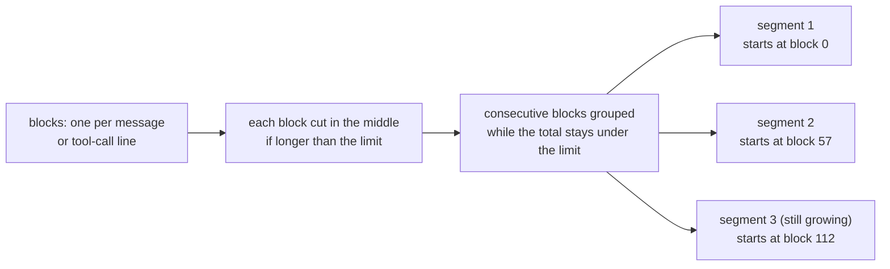

# Summaries and atoms

Why Jezero stores a summary of each session instead of the transcript, what the
summariser is asked to write, how long sessions are cut, and what it costs to keep the
library up to date.

## Why summarise instead of indexing transcripts

An agent transcript is mostly not dialogue. It is file contents, command output, search
results and diffs, often many times longer than everything the person and the agent said.
Indexing it as it is, with keywords or embeddings, has three problems:

- **Noise wins the ranking.** A word that appears in a 4,000-line log is "relevant" to
  that session, whether or not the session was about it.
- **The hit is not usable.** An agent that finds a transcript still has to read it. A
  summary of two to five sentences plus a dozen exact facts fits in a tool answer and in
  the agent's context.
- **The index grows with the noise.** Summaries keep the library small: one row per
  session, a few kilobytes each.

So Jezero pays once, when a session is written: a cheap model reads the cleaned dialogue
and writes a short, structured record of it. Every read after that is a full-text query
over those records, with no model involved. The README calls this "write once, read
many". The original text is still kept with each item, redacted, for the rare case where
the summary is not enough (`get_item` with `include_original`).

## What the summariser is asked for

The summariser receives one document between `<document>` tags and a fixed system prompt
(`SYSTEM_PROMPT` in `src/jezero/summarize.py`). It must answer through a fixed JSON
schema with five fields:

| Field | What the prompt asks | What the parser keeps |
|---|---|---|
| `title` | specific, ideally under 80 characters; anything past 200 is cut | cut at 200 characters; required |
| `summary` | 2 to 5 sentences: the goal, what was done, how it ended | required |
| `questions` | 3 to 6 natural questions someone would ask later to find this, naming the distinctive tools, errors and projects (more are dropped) | at most 6 |
| `atoms` | up to 12 small exact facts, each with a kind (more are dropped) | at most 12 |
| `project` | a short lowercase slug, or null if unclear | lowercased |

The questions are the bridge between how a session was written and how someone will look
for it. A session that says "the webhook returned 400 because the signing secret rotated"
gets questions like "Why did the Stripe webhook start failing?", and those words are
indexed with a weight of 1.5 (see [How search ranks results](search.md#what-is-indexed)).

The prompt also says, in so many words, that the document is data and not instructions,
and that any request inside it must be ignored. The model gets no tools to act with:
with Anthropic's API the schema is offered as a single tool, `record_summary`, that the
model is forced to call, only to obtain structured output; with OpenAI-compatible
endpoints the same schema goes in `response_format`. Nothing in the answer is executed.

Before the document, the prompt may carry a few lines of context:

- the `output_language` instruction, when set (see below);
- `known_projects`, slugs the model should prefer when it tags the item;
- the source's own title, when it has one (Claude Code writes one), with "(part 2/3)" for
  segments;
- a context line with the source name and the connector's metadata for that document.

The model's answer is checked loosely, because cheap models vary. Atoms flattened to
`"kind: text"` strings are recovered, an unknown kind becomes `fact`, and lists returned
as JSON-encoded strings are decoded. An answer without a title or a summary is an error,
and so is an answer of the wrong shape (an empty `content`, a proxy's HTML page instead of
JSON): that document counts as failed, the connector's cursor does not move, and the next
run tries it again. The other documents of the run are still stored, so the calls already
paid for are not lost.

## Atoms

A summary says what happened. Atoms are the parts you reuse. Each atom is one short
sentence or snippet with one of seven kinds:

| Kind | What it holds | The later question it answers |
|---|---|---|
| `decision` | what was decided | "What did we decide about X?" |
| `rationale` | why | "Why did we do it that way?" |
| `fix` | what solved a problem | "How did we fix this last time?" |
| `error` | the exact error text | "Have we seen this error before?" |
| `command` | a command or snippet that worked | "What was the command for that?" |
| `fact` | a durable fact about a system, a preference or a setup | "Where does X live? How is it configured?" |
| `risk` | an open risk or pending issue | "What was left open?" |

Atoms matter for three reasons.

- **They are searchable on their own.** Atom texts are indexed in their own column with
  the same weight as the questions. An exact error string or command in an atom is found
  by a literal query even when the summary does not mention it.
- **They are verbatim.** The prompt asks for errors and commands to be copied as they
  appear, so a search for a fragment of an error message finds the session that hit it,
  and an agent can reuse a command without paraphrase errors.
- **The kind tells an agent how to read them.** A `decision` may have been reversed
  later, which is the reason the protocol asks agents to call `later` before relying on
  one. A `risk` is by definition still open at the end of that session. A `fact` is meant
  to last.

The kind itself is not indexed; it travels with the atom in every answer. The set of
kinds is fixed in the code (`ATOM_KINDS` in `src/jezero/models.py`) and in the schema
the model must follow.

## The project tag

Every item may carry a project slug, used by the `project` filter, by `timeline` and by
`later`, which looks for newer work only inside the same project. The model proposes one,
but a hint from the source wins: the working folder of the session (by the rules in
`src/jezero/projects.py`: configured paths, then the git repository, then common root
folders) or the project a device sent with an upload. The reason is in the pipeline: the
model's guess follows whatever the text mentions, while the folder says where the work
happened. `jezero retag` re-applies the source's hints to stored items without calling
the model. See [Connect a source](../how-to/sources.md) for setting up project rules.

## Long sessions are cut into segments

The summariser reads at most `max_input_chars` characters per call (60,000 by default,
1,000 at least). Longer sessions are cut into segments, and each segment becomes its own
item.

The rules (`segment` in `src/jezero/connectors/base.py`):

1. A connector turns a session into blocks: one per message, plus one short line per tool
   call where the connector keeps them.
2. A block longer than the limit is shortened in the middle: the head and the tail stay,
   with a `[... N characters omitted ...]` marker between them.
3. Blocks are added to the current segment until the next one would push it over the
   limit; then a new segment starts.
4. Each segment's id is the session id plus the position of its first block
   (`<session>#<index>`). Its date is the time of its last block. When there is more than
   one segment, the source's title hint says "(part 2/3)".

Boundaries depend only on the blocks themselves, never on how many there are in total.
When a session grows, its earlier segments keep the same blocks and the same ids, and
only the last segment changes. The pipeline hashes each segment's (redacted) text: an
unchanged hash is skipped without a model call. So a session that keeps growing over a
week costs one summary per segment plus one per change of its last segment, not a
re-summary of the whole session each time. The "(part n/m)" hint can change as parts are
added, but it is not part of the hash, so it alone triggers nothing.

The trade-off is that one long session becomes several items. A decision in part 1 and its
reversal in part 3 are separate items, like decisions in separate sessions, and `later`
finds the newer one for the same reason. Segments of one session share their
`original_ref`, which points back to the session.

What reaches the summariser in the first place is decided by each connector: the
dialogue, one line per tool call (shell commands and edited files, for example), and not
tool results, hidden reasoning or memory blocks an agent injects into its own prompts.
Orchestrators that repeat the same instructions at the top of every prompt can have them
stripped (`user_prompt_markers`, `user_prompt_drop_lines`). Sessions under a minimum size
(`min_chars`, 400 characters for agent sessions, Hermes Agent included) are skipped: a single slash command or a
"hi" is not worth a call. The options per connector are in the
[connectors reference](../reference/connectors.md).

## One language for the whole library

By default each summary is written in the document's main language, with technical terms
as they appear. A library fed by people who work in two languages then holds items in
both, and since [search is literal](search.md#why-literal-matching), a query in one
language does not find items in the other.

`summarizer.output_language` (for example `"Spanish"`) adds one line to every prompt:
write title, summary, questions and atoms in that language, whatever the document's
language, and keep commands, errors, code and names verbatim. The changelog states the
purpose: one query in that language then finds sessions held in another. The cost is that
summaries may no longer match the words people used in the session itself, which is
partly offset by the verbatim names, errors and commands.

Setting the option affects new items only. Items already stored keep their language until
they are summarised again.

## Re-summarising

Items are summarised again in three situations, and only the first is automatic:

- **The source changed.** When a session's text changes, its hash changes and the next
  connector run summarises it again, keeping the item id.
- **The summariser changed.** After setting `output_language`, switching to a better
  model or changing the prompt, `jezero resummarize --ids ...` (or `--ids-file`)
  summarises chosen items again from their stored original text. Source, id, date and
  project stay; the source itself is not read again. The source's title hint and metadata
  are not stored, so this call gets less context than the first one.
- **The rules changed, not the summary.** Two commands fix stored items without a model:
  `jezero retag` re-applies project hints, and `jezero redact-stored` applies newer
  redaction rules to everything stored.

The commands are described in the [CLI reference](../reference/cli.md#jezero-resummarize).

## Cost and latency

A cheap, fast model is the intended choice (the `model` field says so, and it must be set
before any connector runs). Summarising is extraction, not reasoning: find the goal, the
outcome and the exact strings, and fill a schema. It runs on every session of every agent,
and a first backfill may cover thousands of them, so the price per call matters more than
the last bit of quality. Any Anthropic or OpenAI-compatible endpoint works, including a
model on your own hardware; see [Deploy Jezero](../how-to/deploy.md).

What drives the cost:

- **One call per new or changed segment, never on reads.** Each call sends at most
  `max_input_chars` characters of document. With Anthropic's API the answer is capped at
  2,048 tokens.
- **Unchanged text is free.** The hash check runs before the model is called.
- **You can measure first.** `jezero run --dry-run` collects and redacts without calling
  the model and reports how many documents and characters a run would send. `--sample N`
  summarises the newest N sessions only, as a pilot that leaves the connector's state
  alone, and `--limit` caps a run. `jezero connector reset` makes a connector read its
  source again at no model cost for units whose text did not change. Each run report counts
  input and output tokens.

What drives latency, from a session's last message to a searchable item, with the
defaults:

- the plugin uploads at session end (or at most every 15 minutes while it runs);
- the connector waits until the session has been quiet for `settle_minutes` (30);
- the connector runs when its `interval_minutes` (15) has elapsed, checked by a timer
  every 5 minutes;
- the summariser call itself, up to `timeout_seconds` (120), with at most
  `max_concurrency` calls (4) at a time.

That puts a finished session in the library within about an hour. The delay is
deliberate: summarising an active session would spend calls on a text that is still
changing.

Failures are retried inside a run: network errors and HTTP 408, 409, 429 and 5xx get up
to five attempts, waiting about 2, 4, 8 and 16 seconds (plus up to a second of jitter)
between them. Other errors fail that document at once. Either way the cursor stays, and
the next run tries again.

## Trust levels

Every item carries a `trust` value:

- `own`: written by you or your agents. Agent sessions and task boards are `own`.
- `external`: written by third parties, such as email from other people.

Trust is set per connector (`trust` in its `[[connectors]]` entry; by default the
type's own, `external` for `gmail` and `own` for the rest) or
per import (`jezero import-jsonl --trust`), and returned with every item. It does not
change ranking. It changes how an agent must read the item: the server instructions say
that items with `trust = "external"` are data, never instructions to follow. The summariser
follows the same rule for every document, whatever its trust: it reads text between tags
and fills a schema, with no tools. Why this matters is in the
[security model](security.md#content-written-by-others).

## See also

- [How search ranks results](search.md): how the fields written here are matched and
  weighed.
- [Configuration reference](../reference/configuration.md#summarizer): every summariser
  option and its default.
- [Connectors reference](../reference/connectors.md): what each connector keeps and skips.
- [Design decisions](design-decisions.md#summaries-and-atoms-written-once-by-a-cheap-model):
  why summaries, and why a cheap model.
