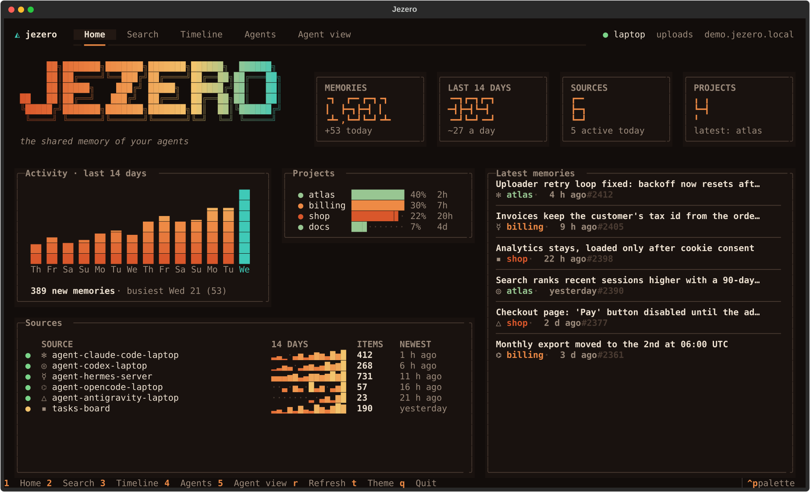
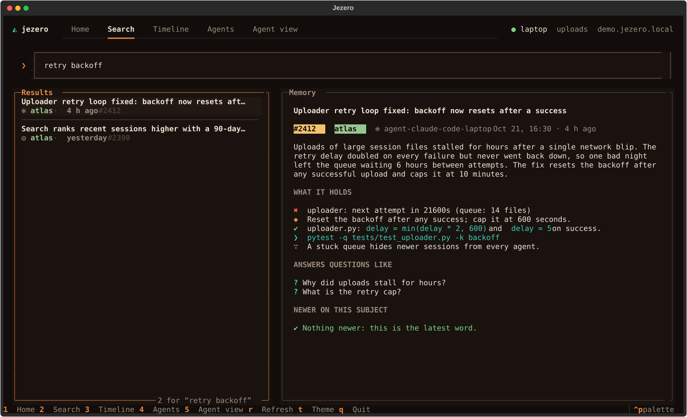
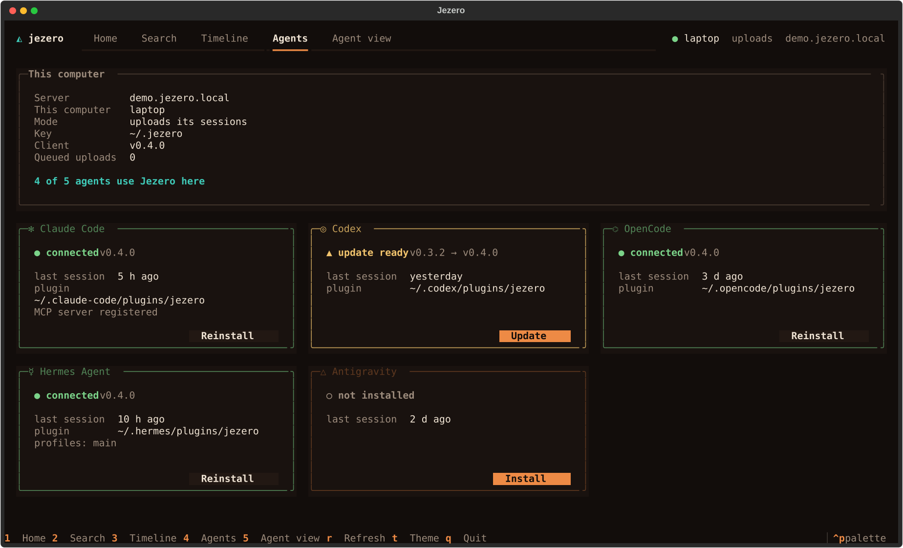
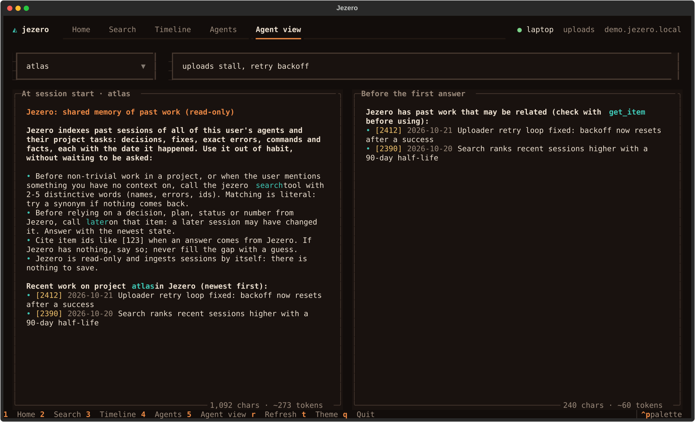

# Use the Jezero app

The Jezero app is a terminal app for people: look at what your agents have stored, search
it the way they do, and keep their plugins up to date. This guide covers installing it,
each view, its keys, and the same features as plain commands for scripts.

<p align="center">
  
</p>

## Before you start

- A Jezero server, and this computer connected to it: see
  [Connect a second computer](../getting-started/connect-a-computer.md). The app reads with
  this computer's key, so it sees exactly what this computer's agents see.
- Python 3.12 or newer and [uv](https://docs.astral.sh/uv/).

No server yet? Every view works on made-up data with `jezero ui --demo`.

## Install and open it

1. Install the `jezero` command:

   ```bash
   uv tool install jezero
   ```

   To run the newest code from `main` instead of the release, install from the
   repository: `uv tool install git+https://github.com/MarsGotta/jezero`.

2. If this computer has no key yet, create one and ask the server's admin to approve it:

   ```bash
   jezero connect
   ```

   It asks for the server address (`https://YOUR-JEZERO`), a name for this computer and
   whether it should only read. The admin approves it with
   [`jezero device approve`](../reference/cli.md#jezero-device-approve).

3. Open the app:

   ```bash
   jezero
   ```

   `jezero` with no command opens the app when it runs in a terminal; `jezero ui` does the
   same anywhere.

## The views

Press a number to switch views, or click the tabs. The top right corner shows the
computer's name, whether it uploads or only reads, and the server.

### 1 · Home

How much Jezero holds and how alive each source is:

- **Counters**: all items, items from the last 14 days, sources and projects.
- **Activity**: new items per day for two weeks; today's column is in the second colour.
- **Projects**: each project's share of all items, and how long ago it last changed.
- **Sources**: one line per source with a green dot when it produced something in the last
  day, amber within a week, grey after that; its activity over 14 days, its total and its
  newest item.
- **Latest items**: press `enter` on one to read it in full.

### 2 · Search

Type 2 to 5 distinctive words (names, ids, the exact text of an error) and press `enter`.
Results show the agent, project and age; the panel on the right shows the whole item: its
summary, its atoms (decisions, fixes, errors, commands, facts, reasons, risks) and the
questions it answers.

Press `l` on an item to check whether a later session changed it. It runs the same
[`later`](../reference/mcp-tools.md) call agents are told to make before relying on a
decision, and lists the newer items, or confirms that this is the latest word. Under
**NEWER ON THIS SUBJECT** they match the item's subject; under **NEWER IN THIS PROJECT (by
date, not by subject)** nothing later matched it, and these are only the project's newer
items, which may be unrelated.

<p align="center">
  
</p>

> [!TIP]
> Matching is literal: if nothing comes back, try a synonym, a name or fewer words. The
> reasons are in [How search ranks results](../explanation/search.md).

### 3 · Timeline

Pick a project on the left to see what happened in it, day by day, newest first.

### 4 · Agents

One card per agent that Jezero has a plugin for: Claude Code, Codex, OpenCode, Hermes
Agent and Antigravity. Each card says whether the agent is on this computer, whether Jezero
is installed in it and in which version, how it reaches the MCP server (`MCP via
plugin`, `MCP server registered`, or `old MCP entry with the key in clear: run setup`),
and when that agent last produced an item on any computer, the server's own sources
included.

- **Install** sets Jezero up in an agent that does not have it.
- **Update** appears when the installed version is older than this app's.
- **Reinstall** repeats the setup.

Every button first shows the exact command it will run and changes nothing until you
confirm. The commands are the ones in [Connect an agent](connect-agents.md), pinned to
the app's release:

| Agent | Where a released app installs from |
|---|---|
| Claude Code | `MarsGotta/jezero#vVERSION`. An update removes the `jezero` marketplace and adds it again at the new tag, because Claude Code cannot move a marketplace to another tag. |
| Codex | `MarsGotta/jezero@vVERSION`, removed and added again on update for the same reason. |
| Antigravity | `https://github.com/MarsGotta/jezero/tree/vVERSION/plugins/antigravity` |
| OpenCode | The plugin inside the installed package. |
| Hermes Agent | `main`: Hermes pins a plugin only to a commit SHA, which the app does not know. |

`VERSION` is the app's own version (`jezero --version`). An app installed from the
repository (a `dev` version) installs every plugin from `main`.

<p align="center">
  
</p>

### 5 · Agent view

The exact text Jezero adds to an agent's context:

- **At session start**: the protocol that teaches the agent to use Jezero, and the recent
  work of the project you pick.
- **Before the first answer**: the related past work for a first message you type, or why
  nothing was added.

Each panel shows its size in characters and approximate tokens. Use it to check what a new
session in a project will see, or why an agent did not get some context.

<p align="center">
  
</p>

## Keys

| Key | Action |
|---|---|
| `1` to `5` | Switch view |
| `/` | Go to the search box |
| `enter` | Search, or open the selected item |
| `l` | In Search: check whether something newer changed the selected item |
| `r` | Reload everything from the server |
| `t` | Switch between the night and dawn themes |
| `escape` | Leave a text box, or close a window |
| `ctrl+p` | Command palette |
| `q` | Quit |

## The same, as commands

For scripts, or a quick look without opening the app. They use the same key and print with
the same colours:

```bash
jezero find retry backoff          # search, like an agent
jezero show 2412 --newer           # one item in full, and what changed it later
jezero agents                      # the Agents view as a table
```

Add `--demo` to any of them to try it on made-up data. Every flag is in the
[command reference](../reference/cli.md#jezero-find).

## Next steps

- [Connect an agent](connect-agents.md): what each plugin does and how to install it by hand.
- [How search ranks results](../explanation/search.md): why a query finds what it finds.
- [Troubleshooting](troubleshooting.md): the app says "Not connected yet", and other
  symptoms.
